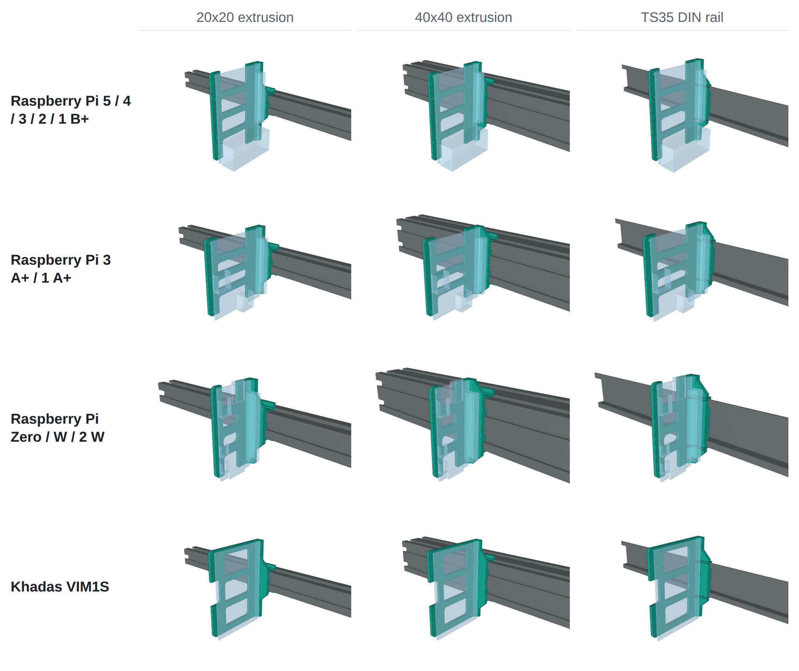

<div align="center">

# SBC Frame Brackets

**Screwless, support-free 3D-printed brackets that clip single-board computers<br>onto aluminium extrusion and DIN rail.**

<picture>
  <source media="(prefers-color-scheme: dark)" srcset="docs/images/hero-dark.png">
  
</picture>


[Supported boards](#supported-boards) · [Models](#models) · [Printing](#printing) · [Mounting](#mounting) · [Building from source](#building-from-source) · [Customising](#customising)

</div>

Use a 20x20 or 40x40 aluminium extrusion like a DIN rail and line your single-board computers up side by side, or clip the same boards onto a real TS35 DIN rail.
Every Raspberry Pi with mounting holes is covered, from the Raspberry Pi 1 B+ to the Raspberry Pi 5.
Every shape is generated by a Python script with [build123d](https://github.com/gumyr/build123d), so you can change the dimensions or add your own board and rebuild everything.

## Highlights

- **No screws into the frame.** Push the bracket straight on from the front. Hooks catch the slots, and a key in the front slot carries the weight.
- **Either way up.** The grip is identical at the top and bottom, so the whole bracket can be mounted upside down.
- **No supports.** Prints front plate down. The 3MF and STL files are already oriented and centred on the plate.
- **The whole Raspberry Pi range.** One bracket per board size: Raspberry Pi 5, 4, 3, 2 and 1 B+ share one, the A+ boards share one, and the Zero family shares one.
- **Three mounts.** 20x20 extrusion, 40x40 extrusion (6 mm slot) and TS35 x 7.5 DIN rail.
- **Checked in CAD.** `--check` measures interference with the frame and the board, unsupported area and an estimated print time.
- **Offline 3D viewer.** Download `models/viewer.html` and open it in any browser with WebGL. No network connection needed.

## Supported boards

| Board | Board size | Bracket |
|---|---|---|
| Raspberry Pi 5 | 85 x 56 mm | `PiB` |
| Raspberry Pi 4 Model B | 85 x 56 mm | `PiB` |
| Raspberry Pi 3 Model B+ | 85 x 56 mm | `PiB` |
| Raspberry Pi 3 Model B | 85 x 56 mm | `PiB` |
| Raspberry Pi 2 Model B | 85 x 56 mm | `PiB` |
| Raspberry Pi 1 Model B+ | 85 x 56 mm | `PiB` |
| Raspberry Pi 3 Model A+ | 65 x 56 mm | `PiA` |
| Raspberry Pi 1 Model A+ | 65 x 56 mm | `PiA` |
| Raspberry Pi Zero / Zero W / Zero WH | 65 x 30 mm | `PiZero` |
| Raspberry Pi Zero 2 W (with or without headers) | 65 x 30 mm | `PiZero` |
| Khadas VIM1S | 82 x 56.6 mm | `VIM1S` |

The board outlines and mounting holes were taken from the official mechanical drawings (see [`DESIGN_NOTES.md`](DESIGN_NOTES.md) section 7).

<details>
<summary><b>Not covered</b></summary>

- **Raspberry Pi 1 Model A / Model B**: no official mechanical drawing is published, so the mounting holes cannot be checked.
- **Compute Modules**: they need a carrier board. Mount the carrier board instead.
- **Raspberry Pi 400 / 500**: keyboard computers.
- **Raspberry Pi Pico**: a microcontroller board, not a single-board computer.

</details>

## Models

<picture>
  <source media="(prefers-color-scheme: dark)" srcset="docs/images/gallery-dark.png">
  
</picture>

`models/` contains 3MF, STL and STEP files for all 24 models.

| | 20x20 extrusion | 40x40 extrusion | TS35 DIN rail |
|---|:-:|:-:|:-:|
| **Raspberry Pi 5 / 4 / 3 / 2 / 1 B+** (`PiB`) | [3MF](models/PiB_2020.3mf) · [STL](models/PiB_2020.stl) · [STEP](models/PiB_2020.step) | [3MF](models/PiB_4040.3mf) · [STL](models/PiB_4040.stl) · [STEP](models/PiB_4040.step) | [3MF](models/PiB_DIN35.3mf) · [STL](models/PiB_DIN35.stl) · [STEP](models/PiB_DIN35.step) |
| ↳ with standoffs | [3MF](models/PiB_2020_spacer.3mf) · [STL](models/PiB_2020_spacer.stl) · [STEP](models/PiB_2020_spacer.step) | [3MF](models/PiB_4040_spacer.3mf) · [STL](models/PiB_4040_spacer.stl) · [STEP](models/PiB_4040_spacer.step) | [3MF](models/PiB_DIN35_spacer.3mf) · [STL](models/PiB_DIN35_spacer.stl) · [STEP](models/PiB_DIN35_spacer.step) |
| **Raspberry Pi 3 A+ / 1 A+** (`PiA`) | [3MF](models/PiA_2020.3mf) · [STL](models/PiA_2020.stl) · [STEP](models/PiA_2020.step) | [3MF](models/PiA_4040.3mf) · [STL](models/PiA_4040.stl) · [STEP](models/PiA_4040.step) | [3MF](models/PiA_DIN35.3mf) · [STL](models/PiA_DIN35.stl) · [STEP](models/PiA_DIN35.step) |
| ↳ with standoffs | [3MF](models/PiA_2020_spacer.3mf) · [STL](models/PiA_2020_spacer.stl) · [STEP](models/PiA_2020_spacer.step) | [3MF](models/PiA_4040_spacer.3mf) · [STL](models/PiA_4040_spacer.stl) · [STEP](models/PiA_4040_spacer.step) | [3MF](models/PiA_DIN35_spacer.3mf) · [STL](models/PiA_DIN35_spacer.stl) · [STEP](models/PiA_DIN35_spacer.step) |
| **Raspberry Pi Zero / W / 2 W** (`PiZero`) | [3MF](models/PiZero_2020.3mf) · [STL](models/PiZero_2020.stl) · [STEP](models/PiZero_2020.step) | [3MF](models/PiZero_4040.3mf) · [STL](models/PiZero_4040.stl) · [STEP](models/PiZero_4040.step) | [3MF](models/PiZero_DIN35.3mf) · [STL](models/PiZero_DIN35.stl) · [STEP](models/PiZero_DIN35.step) |
| ↳ with standoffs | [3MF](models/PiZero_2020_spacer.3mf) · [STL](models/PiZero_2020_spacer.stl) · [STEP](models/PiZero_2020_spacer.step) | [3MF](models/PiZero_4040_spacer.3mf) · [STL](models/PiZero_4040_spacer.stl) · [STEP](models/PiZero_4040_spacer.step) | [3MF](models/PiZero_DIN35_spacer.3mf) · [STL](models/PiZero_DIN35_spacer.stl) · [STEP](models/PiZero_DIN35_spacer.step) |
| **Khadas VIM1S** (`VIM1S`) | [3MF](models/VIM1S_2020.3mf) · [STL](models/VIM1S_2020.stl) · [STEP](models/VIM1S_2020.step) | [3MF](models/VIM1S_4040.3mf) · [STL](models/VIM1S_4040.stl) · [STEP](models/VIM1S_4040.step) | [3MF](models/VIM1S_DIN35.3mf) · [STL](models/VIM1S_DIN35.stl) · [STEP](models/VIM1S_DIN35.step) |
| ↳ with standoffs | [3MF](models/VIM1S_2020_spacer.3mf) · [STL](models/VIM1S_2020_spacer.stl) · [STEP](models/VIM1S_2020_spacer.step) | [3MF](models/VIM1S_4040_spacer.3mf) · [STL](models/VIM1S_4040_spacer.stl) · [STEP](models/VIM1S_4040_spacer.step) | [3MF](models/VIM1S_DIN35_spacer.3mf) · [STL](models/VIM1S_DIN35_spacer.stl) · [STEP](models/VIM1S_DIN35_spacer.step) |

- **Without standoffs**: the front plate has 3 mm through holes. Bring your own standoffs and screws.
- **With standoffs** (`_spacer`): standoffs are printed as part of the front plate. Screw through the board straight into them.

| Bracket | Standoff height | Outer diameter | Pilot hole | Screws |
|---|---|---|---|---|
| `PiB` | 5 mm | 6 mm | 2.2 mm | M2.5 self-tapping |
| `PiA` | 5 mm | 6 mm | 2.2 mm | M2.5 self-tapping |
| `PiZero` | 3 mm | 6 mm | 2.2 mm | M2.5 self-tapping |
| `VIM1S` | 5 mm | 5 mm | 1.7 mm | M2 self-tapping |

<details>
<summary><b>How the brackets hold on</b></summary>

- **Extrusion grip (all boards)**: identical hooks at the top and bottom catch the slots on the top and bottom faces of the extrusion. A key in the front slot takes the vertical load.
- **DIN rail grip (all boards)**: a centre key sits in the rail channel (between the side walls) and takes the vertical load. Hooks on leaf springs at both sides catch behind the lips.
- Both grips are the same at the top and bottom, so a bracket can be mounted upside down.
- **Front plate**: the same size as the board, with ladder-shaped cut-outs to save material. It is notched where the SD card goes in and out.
- **Board orientation**: ports face outwards, the GPIO side faces the frame.

</details>

## Printing

- The 3MF and STL files are in print orientation (front plate down), centred on a 256 mm square build plate. They are ready to slice.
- No supports needed.
- PETG is recommended. The hook tips are only 0.9 mm thick, and PLA may crack when you push the bracket on.

| Bracket | Estimated print time (20x20 version) |
|---|---|
| `PiB` | ~48 min (with standoffs ~63 min) |
| `PiA` | ~39 min (with standoffs ~53 min) |
| `PiZero` | ~33 min (with standoffs ~41 min) |
| `VIM1S` | ~44 min (with standoffs ~58 min) |

These times are not slicer results. They are estimates from `checks_time.py`, meant for comparing shapes.

## Mounting

**Extrusion**

1. Push the bracket straight onto the extrusion from the front.
2. If it will not go on, slide it in from the end of the extrusion.
3. To remove it, lift the finger tab on one hook and tilt the bracket off.

**DIN rail**

1. Push the bracket straight onto the rail from the front.
2. To remove it, put a flat screwdriver into the gap beside a leaf spring, lever the spring outwards and tilt the bracket off.

## Building from source

Requires Python 3.11–3.14.

```sh
git clone https://github.com/koedame/sbc-frame-brackets.git
cd sbc-frame-brackets
python3 -m venv .venv
. .venv/bin/activate
pip install -r requirements.txt
python build_all.py --check
```

This writes the 3MF, STL and STEP files for every model and `viewer.html` to `models/`.

> [!NOTE]
> On minimal Linux installs (containers, servers), OpenCascade needs libGL. If you see `ImportError: libGL.so.1`, install it, for example with `sudo apt install libgl1` on Debian and Ubuntu.

Tested on Linux ARM64 (Python 3.11, 3.13 and 3.14) and Linux x86-64 (Python 3.11).

| Option | What it does |
|---|---|
| `--check` | Report interference with the frame and the board, unsupported area and estimated print time |
| `--coupons` | Also write fit test coupons (clearance 0.00 / 0.05 / 0.10 mm) |
| `--vim1s-step <path>` | Use the official VIM1S 3D model for interference checks (it is not put in the viewer) |
| `--only PiB PiA` / `--series 20 DIN` | Build only some models (`--only` takes PiB / PiA / PiZero / VIM1S, `--series` takes 20 / 40 / DIN) |
| `--out <dir>` | Write somewhere other than `models/` |
| `--no-viewer` | Do not write `viewer.html` |

<details>
<summary><b>Using the official VIM1S 3D model</b></summary>

The official VIM1S 3D model (`vim1s-pcba-3d-v11.stp`) is distributed by Khadas and is not included here.
You can get it from `blueprints/cad/` for the VIM1S on the [Khadas download site](https://dl.khadas.com/products/). The brackets come out the same without it.
Even when you pass the official model, the viewer shows the VIM1S as a bare board, so that no shape converted from Khadas' files ends up in the distributed `viewer.html`.

</details>

## Customising

All dimensions live in `sbc_brackets.py`.

| To change | Constant in `sbc_brackets.py` |
|---|---|
| Fit on the extrusion | `FIT` (clearance per side, currently 0.05 mm) |
| DIN rail hooks and leaf springs | `DIN_HOOK` (0.8 mm), `DIN_LEAF_T` (1.2 mm), `DIN_FIT` (0.05 mm) |
| Width of the DIN rail centre key | `DIN_KEY_HALF` (half width, currently 12.2 mm) |
| Hook engagement | `HOOK` (currently 1.0 mm) |
| Hook stiffness | `ARM_T` (1.6 mm at the root), `ARM_TIP` (0.9 mm at the tip) |
| Width along the rail | `W` (currently 16 mm) |
| Board hole diameter | `HOLE_D` in each board class |
| Standoffs | `SPACER` in each board class (height, outer diameter, pilot hole) |

Before changing the fit, print the coupons from `--coupons` and try them on your extrusion.

**Adding a board**

1. Copy the `PiA` class in `sbc_brackets.py`.
2. Change the board outline (`L`, `S`), the mounting holes (`HOLES`) and the notch for the SD card.
3. Add it to `BOARDS`.
4. Run `python build_all.py --check --only <new board>` to check interference and supports.

Take the dimensions from the manufacturer's official 3D model or drawing, not from memory.

## Project layout

| Path | Contents |
|---|---|
| [`DESIGN_NOTES.md`](DESIGN_NOTES.md) | Why things are the way they are: design decisions, rejected ideas, test prints and open items. Read this first if you want to work on the design |
| `sbc_brackets.py` | Shape definitions. Every dimension is here |
| `build_all.py` | Writes the 3MF, STL, STEP and `viewer.html` files |
| `viewer.tpl.html` | Template for the viewer |
| `checks_print.py` | Support check. Slices the part layer by layer and checks each layer stays within 45 degrees of the one below |
| `checks_time.py` | Print time estimate |
| `vendor/` | three.js r128 (MIT license, `vendor/LICENSE-three.txt`) |
| `models/` | Generated models (3MF, STL, STEP) and the viewer |
| `docs/images/` | Images for this README |
| `requirements.txt` | Python packages |

## Status

- The fit and retention were tuned with test prints of the bracket for the Raspberry Pi 4. The other brackets use the same grip but have not been printed yet.
- `PiB` has only been tried with a Raspberry Pi 4. The other B-size boards have the same outline and mounting holes on their official drawings.
- The pilot holes of the integrated standoffs have not been tried on real parts.
- The Raspberry Pi boards are checked for interference against simplified board shapes placed from the official mechanical drawings.
- The VIM1S is checked for interference against its official 3D model.
- The DIN rail versions have not been printed yet. The centre key does not fit aluminium DIN rails with 1.5 mm side walls (see [`DESIGN_NOTES.md`](DESIGN_NOTES.md) section 7).

## Disclaimer

- The strength, retention and heat resistance of printed parts depend on the material and print settings. No warranty is given. Test on real parts before using these with heavy or hot equipment.
- Raspberry Pi, Khadas and VIM1S are trademarks or registered trademarks of their respective owners. This project is not affiliated with or endorsed by them.

## License

The license for the scripts and models in this repository has not been decided yet.

three.js r128 in `vendor/` is under the MIT license (`vendor/LICENSE-three.txt`). The same code is embedded in `models/viewer.html`, together with the full license text as an HTML comment.
