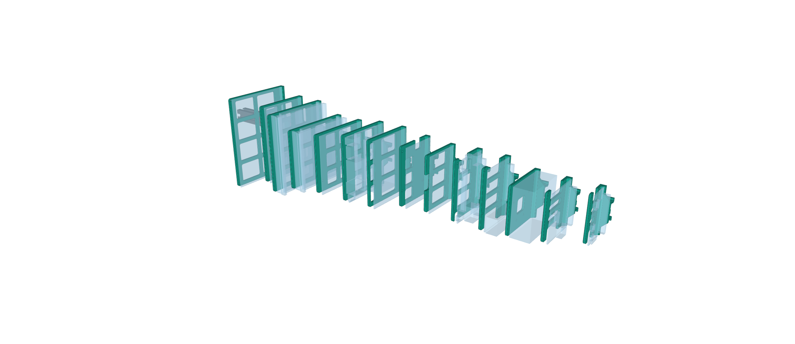
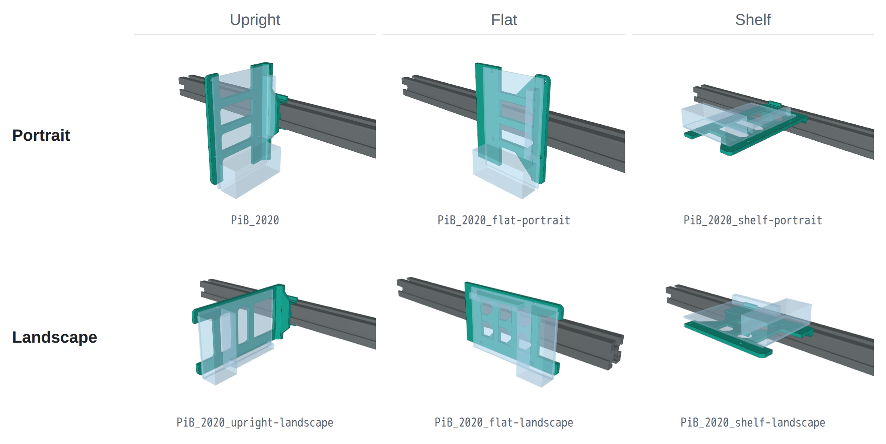

<div align="center">

# SBC Frame Brackets

**Screwless, support-free 3D-printed brackets that clip single-board computers<br>onto aluminium extrusion and DIN rail.**

<picture>
  <source media="(prefers-color-scheme: dark)" srcset="docs/images/hero-dark.png">
  
</picture>


[Supported boards](#supported-boards) · [Orientations](#orientations) · [Download](#download) · [Printing](#printing) · [Mounting](#mounting) · [Building from source](#building-from-source) · [Customising](#customising)

</div>

Use a 20x20 or 40x40 aluminium extrusion like a DIN rail and line your single-board computers up side by side, or clip the same boards onto a real TS35 DIN rail.
Every Raspberry Pi with mounting holes is covered, from the Raspberry Pi 1 B+ to the Raspberry Pi 5, along with popular Radxa, Pine64, Khadas, Hardkernel, Orange Pi, Libre Computer and LattePanda boards, the NVIDIA Jetson Orin Nano Developer Kit, BeagleBoard.org BeagleBone Black and the Sipeed NanoKVM-Desk, each in six orientations.
Ready-made files for every model are attached to the [latest release](https://github.com/koedame/sbc-frame-brackets/releases/latest). Every shape is generated by a Python script with [build123d](https://github.com/gumyr/build123d), so you can change the dimensions or add your own board and rebuild only what you need.

## Highlights

- **No screws into the frame.** Push the bracket straight on from the front. Hooks catch the slots, and a key in the front slot carries the weight.
- **Six orientations.** Stand the board out from the frame, lay it flat against the frame or put it on a shelf above the frame, each in portrait or landscape.
- **Either way up.** The grip is identical at the top and bottom, so every bracket can be mounted upside down.
- **No supports.** Every model prints with the grip on the plate. The 3MF and STL files are already oriented and centred on the plate.
- **Ready to download.** 3MF, STL and STEP files for all 336 models are attached to the latest release, in one zip per bracket. There is nothing to build unless you want to change a shape.
- **The whole Raspberry Pi range.** One bracket per board size: Raspberry Pi 5, 4, 3, 2 and 1 B+ share one, the A+ boards share one, and the Zero family shares one.
- **Other popular boards.** The Radxa ROCK 3C, Pine64 ROCK64, Hardkernel ODROID-C4 and Libre Computer Le Potato fit the `PiB` bracket made for the Raspberry Pi Model B size, the Radxa ZERO 3W / 3E fit the `PiZero` bracket, the Khadas VIM3 / VIM4 fit the `VIM1S` bracket, and the Radxa ROCK 5B / 5B+ have their own, as do the NVIDIA Jetson Orin Nano Developer Kit, the Orange Pi 5 Pro, BeagleBoard.org BeagleBone Black, the Hardkernel ODROID-M2, the LattePanda 3 Delta and the LattePanda Mu on its Lite Carrier. The Hardkernel ODROID-N2+ and ODROID-M1 are held by the heatsink that comes under the board, and the Sipeed NanoKVM-Desk by its case, with two of the case's own screws.
- **Three mounts.** 20x20 extrusion, 40x40 extrusion (6 mm slot) and TS35 x 7.5 DIN rail.
- **Checked in CAD.** `--check` measures interference with the frame and the board, unsupported area, an estimated print time and, for DIN rail, whether the leaf springs have room to bend.
- **Offline 3D viewer.** Download [`viewer.html`](https://github.com/koedame/sbc-frame-brackets/releases/latest/download/viewer.html) from the latest release and open it in any browser with WebGL. No network connection needed.

## Supported boards

| Board | Board size | Bracket |
|---|---|---|
| Raspberry Pi 5 | 85 x 56 mm | `PiB` |
| Raspberry Pi 4 Model B | 85 x 56 mm | `PiB` |
| Raspberry Pi 3 Model B+ | 85 x 56 mm | `PiB` |
| Raspberry Pi 3 Model B | 85 x 56 mm | `PiB` |
| Raspberry Pi 2 Model B | 85 x 56 mm | `PiB` |
| Raspberry Pi 1 Model B+ | 85 x 56 mm | `PiB` |
| Raspberry Pi 3 Model A+ | 65 x 56 mm | `PiA` |
| Raspberry Pi 1 Model A+ | 65 x 56 mm | `PiA` |
| Raspberry Pi Zero / Zero W / Zero WH | 65 x 30 mm | `PiZero` |
| Raspberry Pi Zero 2 W (with or without headers) | 65 x 30 mm | `PiZero` |
| Radxa ROCK 3C | 85 x 56 mm | `PiB` |
| Pine64 ROCK64 | 85 x 56 mm | `PiB` |
| Radxa ZERO 3W | 65 x 30 mm | `PiZero` |
| Radxa ZERO 3E | 65 x 30 mm | `PiZero` |
| Khadas VIM1S | 82 x 56.6 mm | `VIM1S` |
| Khadas VIM3 | 82 x 56.6 mm | `VIM1S` |
| Khadas VIM4 | 82 x 56.6 mm | `VIM1S` |
| Radxa ROCK 5B | 100.2 x 74.2 mm | `ROCK5B` |
| Radxa ROCK 5B+ | 100.2 x 74.2 mm | `ROCK5B` |
| BeagleBoard.org® BeagleBone® Black | 86.4 x 54.6 mm | `BBB` |
| Hardkernel ODROID-C4 | 85 x 56 mm | `PiB` |
| Hardkernel ODROID-M2 | 90 x 90 mm | `M2` |
| Hardkernel ODROID-N2+ (on its heatsink) | 90 x 90 mm (heatsink 100 x 91 mm) | `N2Plus` |
| Hardkernel ODROID-M1 (on its heatsink) | 122 x 90 mm (heatsink 123 x 100 mm) | `M1` |
| Libre Computer AML-S905X-CC (Le Potato) | 84 x 56 mm | `PiB` |
| LattePanda 3 Delta | 125 x 78 mm | `LP3Delta` |
| LattePanda Mu on the Lite Carrier (DFR1142, V1 and V2) | 146 x 102 mm | `MuLite` |
| Orange Pi 5 Pro | 89.1 x 56 mm | `OPi5Pro` |
| NVIDIA Jetson Orin Nano Developer Kit (off its base) | 100 x 79 mm | `OrinNano` |
| NVIDIA Jetson Orin Nano Super Developer Kit (off its base) | 100 x 79 mm | `OrinNano` |
| Sipeed NanoKVM-Desk (NanoKVM Pro, by its case) | 67.1 x 65.4 mm (case) | `NanoKVMDesk` |

The board outlines and mounting holes were taken from the manufacturers' official mechanical drawings, 3D models and manufacturing data (see [`DESIGN_NOTES.md`](DESIGN_NOTES.md) section 7).

<details>
<summary><b>Not covered</b></summary>

- **Raspberry Pi 1 Model A / Model B**: no official mechanical drawing is published, so the mounting holes cannot be checked.
- **Orange Pi 5 / Orange Pi 5 Plus**: their mounting holes are given only in the official 3D models, which have not been checked yet. Not added yet.
- **Compute Modules**: they need a carrier board. Mount the carrier board instead.
- **Raspberry Pi 400 / 500**: keyboard computers.
- **Raspberry Pi Pico**: a microcontroller board, not a single-board computer.
- **Sipeed NanoKVM Lite**: the board has no mounting holes; the only holes in it hold the pegs of the Ethernet jack.
- **Sipeed NanoKVM Full**: Sipeed publishes no 3D model or drawing of its case, only the size, so the screw holes in it cannot be checked.
- **Sipeed NanoKVM-ATX**: goes inside the computer it controls, on a half-height or full-height expansion slot bracket.
- **Sipeed NanoKVM-PCIe**: a card for a PCIe slot inside the computer it controls.
- **Sipeed NanoKVM-USB**: a dongle on the cables between two computers.
- **LattePanda Mu on other carrier boards**: the Mu is a compute module, so the bracket is for the carrier board. On the Mini Carrier (DFR1293) the module and its cooler hang under the carrier, about 29 mm deep, which needs a different design. The Full EVA Carrier (DFR1141) is a 170 x 170 mm Mini-ITX board, and the GPU Carrier (DFR1144) comes as a kit with its graphics card. Not added yet.

</details>

## Orientations

<picture>
  <source media="(prefers-color-scheme: dark)" srcset="docs/images/orientations-dark.png">
  
</picture>

Every board comes in all six orientations on all three mounts. The grip on the frame is the same in all of them.
The upright orientations also come with integrated standoffs; the flat and shelf orientations do not (see [Download](#download)).

| Orientation | File name suffix | Where the board sits | Rail length used (`PiB`) | Reaches out from the frame (`PiB`) |
|---|---|---|---|---|
| Upright, portrait | none (`PiB_2020`) | Stands out from the frame at right angles to the rail, long side vertical | 16 mm | 63 mm |
| Upright, landscape | `_upright-landscape` | Stands out at right angles to the rail, long side pointing away from the frame | 16 mm | 105 mm |
| Flat, portrait | `_flat-portrait` | Parallel to the front of the frame, beside the grip, long side vertical | 72 mm | 3 mm plate, then the standoffs and the board |
| Flat, landscape | `_flat-landscape` | Parallel to the front of the frame, beside the grip, long side along the rail | 101 mm | 3 mm plate, then the standoffs and the board |
| Shelf, portrait | `_shelf-portrait` | Lies on a shelf level with the top of the grip, components up, long side pointing away from the frame | 56 mm | 105 mm |
| Shelf, landscape | `_shelf-landscape` | Lies on a shelf level with the top of the grip, components up, long side along the rail | 85 mm | 63 mm |

The upright orientations take the least rail, so they are the ones for lining many boards up side by side.
The flat orientations keep the board closest to the frame. The shelf orientations keep the board horizontal and above the frame.

## Download

<picture>
  <source media="(prefers-color-scheme: dark)" srcset="docs/images/gallery-dark.png">
  
</picture>

Every model is attached to the [latest release](https://github.com/koedame/sbc-frame-brackets/releases/latest): one zip per bracket with the 3MF, STL and STEP files of all its models, 336 models in all, and next to them the [offline viewer](https://github.com/koedame/sbc-frame-brackets/releases/latest/download/viewer.html) and the fit test coupons.
The links below always point to the latest release.

| Bracket | Boards | Download |
|---|---|:-:|
| `PiB` | Raspberry Pi 5 / 4 / 3 / 2 / 1 B+, Radxa ROCK 3C, Pine64 ROCK64, Hardkernel ODROID-C4, Libre Computer Le Potato | [PiB.zip](https://github.com/koedame/sbc-frame-brackets/releases/latest/download/PiB.zip) |
| `PiA` | Raspberry Pi 3 A+ / 1 A+ | [PiA.zip](https://github.com/koedame/sbc-frame-brackets/releases/latest/download/PiA.zip) |
| `PiZero` | Raspberry Pi Zero / W / 2 W, Radxa ZERO 3W / 3E | [PiZero.zip](https://github.com/koedame/sbc-frame-brackets/releases/latest/download/PiZero.zip) |
| `VIM1S` | Khadas VIM1S / VIM3 / VIM4 | [VIM1S.zip](https://github.com/koedame/sbc-frame-brackets/releases/latest/download/VIM1S.zip) |
| `ROCK5B` | Radxa ROCK 5B / 5B+ | [ROCK5B.zip](https://github.com/koedame/sbc-frame-brackets/releases/latest/download/ROCK5B.zip) |
| `BBB` | BeagleBoard.org BeagleBone Black | [BBB.zip](https://github.com/koedame/sbc-frame-brackets/releases/latest/download/BBB.zip) |
| `M2` | Hardkernel ODROID-M2 | [M2.zip](https://github.com/koedame/sbc-frame-brackets/releases/latest/download/M2.zip) |
| `LP3Delta` | LattePanda 3 Delta | [LP3Delta.zip](https://github.com/koedame/sbc-frame-brackets/releases/latest/download/LP3Delta.zip) |
| `MuLite` | LattePanda Mu Lite Carrier | [MuLite.zip](https://github.com/koedame/sbc-frame-brackets/releases/latest/download/MuLite.zip) |
| `N2Plus` | Hardkernel ODROID-N2+ (on its heatsink) | [N2Plus.zip](https://github.com/koedame/sbc-frame-brackets/releases/latest/download/N2Plus.zip) |
| `M1` | Hardkernel ODROID-M1 (on its heatsink) | [M1.zip](https://github.com/koedame/sbc-frame-brackets/releases/latest/download/M1.zip) |
| `OPi5Pro` | Orange Pi 5 Pro | [OPi5Pro.zip](https://github.com/koedame/sbc-frame-brackets/releases/latest/download/OPi5Pro.zip) |
| `OrinNano` | NVIDIA Jetson Orin Nano Developer Kit / Super | [OrinNano.zip](https://github.com/koedame/sbc-frame-brackets/releases/latest/download/OrinNano.zip) |
| `NanoKVMDesk` | Sipeed NanoKVM-Desk (by its case) | [NanoKVMDesk.zip](https://github.com/koedame/sbc-frame-brackets/releases/latest/download/NanoKVMDesk.zip) |

Each zip unpacks to a folder named after the bracket with 72 files: the 3MF, STL and STEP files of eight models on each of the three mounts (`2020`, `4040` and `DIN35`).
File names are `<bracket>_<mount>[_<orientation>][_spacer]`; upright portrait has no orientation suffix. For `PiB` on a 20x20 extrusion:

| Orientation | Without standoffs | With standoffs |
|---|---|---|
| Upright, portrait | `PiB_2020` | `PiB_2020_spacer` |
| Upright, landscape | `PiB_2020_upright-landscape` | `PiB_2020_upright-landscape_spacer` |
| Flat, portrait | `PiB_2020_flat-portrait` | none |
| Flat, landscape | `PiB_2020_flat-landscape` | none |
| Shelf, portrait | `PiB_2020_shelf-portrait` | none |
| Shelf, landscape | `PiB_2020_shelf-landscape` | none |

- **Without standoffs**: the board plate has 3 mm through holes (2.4 mm on `VIM1S` and `NanoKVMDesk`, for M2). Bring your own standoffs and screws.
- **With standoffs** (`_spacer`, upright orientations only): standoffs are printed as part of the board plate. Screw through the board straight into them (on `N2Plus` and `M1`, from under the plate into the heatsink, and on `NanoKVMDesk` into the case; see below).
- **Fit test coupons**, attached on their own: `fit_test_2020_1.stl` to `_3.stl` and `fit_test_4040_1.stl` to `_3.stl` (clearance 0.00 / 0.05 / 0.10 mm, told apart by the number of notches).

| Bracket | Standoff height | Outer diameter | Pilot hole | Screws |
|---|---|---|---|---|
| `PiB` | 5 mm | 6 mm | 2.2 mm | M2.5 self-tapping |
| `PiA` | 5 mm | 6 mm | 2.2 mm | M2.5 self-tapping |
| `PiZero` | 3 mm | 6 mm | 2.2 mm | M2.5 self-tapping |
| `VIM1S` | 5 mm | 5 mm | 1.7 mm | M2 self-tapping |
| `ROCK5B` | 8 mm | 5.4 mm | 2.2 mm | M2.5 self-tapping |
| `BBB` | 6 mm | 6 mm | 2.6 mm | M3 self-tapping |
| `M2` | 8 mm | 6 mm | 2.6 mm | M3 self-tapping |
| `LP3Delta` | 8 mm | 6 mm | 2.6 mm | M3 self-tapping |
| `MuLite` | 5 mm | 6 mm | 2.6 mm | M3 self-tapping |
| `N2Plus` | 10 mm | 5 mm (8 mm at the foot) | 3.4 mm, through | M3 x 16 from under the plate into the heatsink |
| `M1` | 10 mm | 5 mm (8 mm at the foot) | 3.4 mm, through | M3 x 16 from under the plate into the heatsink |
| `OPi5Pro` | 8 mm | 5 mm | 2.2 mm | M2.5 self-tapping |
| `OrinNano` | 8 mm | 5 mm | 2.2 mm | M2.5 self-tapping |
| `NanoKVMDesk` | 3 mm | 6 mm | 2.4 mm, through | M2 x 12 from under the plate into the case, in the two rear standoffs (the front two are rests) |

On `ROCK5B`, the 8 mm clears the parts under the board in the official 3D models (the deepest reach 5.4 mm below the ROCK 5B+) and the ROCK 5B's microSD card, which sticks out past the GPIO edge of the board. Use standoffs at least 8 mm tall with the version without standoffs too. An SSD fitted in the M.2 slots under the board is not part of the models and has not been checked.

On `BBB`, the micro HDMI and mini USB sit under the board and their heights are not published, so the plate is notched under them (the micro HDMI notch is also the notch for the microSD card). The models were checked with the board 6 mm above the plate: use standoffs at least 6 mm tall with the version without standoffs too. The board holes are 1/8 in (3.175 mm), for M3 screws, so the 3 mm holes of the version without standoffs are a tight fit for them.

On `M2`, the 8 mm clears the parts under the board in the official 3D model: the deepest is a connector next to the UART label, 6.8 mm below the board, then the RTC battery holder at 6.5 mm. An M.2 2280 SSD sits on the board's 4.1 mm standoff and reaches about 6.5 mm; it is not part of the model. Use standoffs at least 8 mm tall with the version without standoffs too. The board holes are 3.3 mm, for M3 screws, so the 3 mm holes of the version without standoffs are a tight fit for them.

On `LP3Delta`, the 8 mm clears the parts under the board in the official 3D model: the deepest are the standoffs of the two M.2 slots, 5.1 mm below the board, and the M.2 cards drawn in the model reach 4.4 mm. Use standoffs at least 8 mm tall with the version without standoffs too. The board holes are 3.2 mm, for M3 screws, so the 3 mm holes of the version without standoffs are a tight fit for them.

On `MuLite`, the 5 mm clears the pins of the PCIe slot, the deepest part under the carrier in the official 3D model (3.3 mm below the board). Use standoffs at least 5 mm tall with the version without standoffs too. The LattePanda Mu module, its cooler and the M.2 cards go on top of the carrier, inside its outline. The carrier's holes are 3.2 mm, for M3 screws, so the 3 mm holes of the version without standoffs are a tight fit for them.

On `N2Plus` and `M1` the bracket holds the heatsink, not the board. Both boards come screwed to the top of an aluminium heatsink that is also their stand, fins down, so the plate is the size of the heatsink and its holes line up with four M3 threaded holes in the heatsink's base that the board does not use. They open between a side wall and the outermost fin. The 10 mm standoffs keep the heatsink 4 mm off the plate. Their top 6.5 mm goes up between the side wall and the fin, so it is only 5 mm across (0.4 mm from the fin), and 8 mm below that. Put M3 x 16 screws in from under the plate, through the standoffs and into the heatsink: 3 mm of plate, 10 mm of standoff and the 3 mm base, so each screw ends flush with the top of the base, under the board. Do not use longer screws, and leave room for the screw heads under the plate when brackets sit side by side. In the flat orientations the back of the plate lies against the frame, so countersink the four holes on the back and use countersunk M3 x 16 screws, put in before the bracket goes on the frame. The standoffs have not been tried on a real heatsink. With the version without standoffs, use plain (unthreaded) round M3 spacers 10 mm long and no more than 5 mm across, with the same M3 x 16 screws, which are a tight fit in the 3 mm plate holes.

On `OPi5Pro`, how far the parts under the board reach is not published and there is no official 3D model. The 8 mm is meant to leave room for an M.2 2280 SSD in the slot under the board, as on the other boards with an M.2 slot underneath (on the ODROID-M2 an SSD reaches about 6.5 mm below the board), but it has not been checked with an SSD fitted. Use standoffs at least 8 mm tall with the version without standoffs too, no more than 5.6 mm across, corners included: the nearest parts under the board are 2.8 mm from a hole centre.

On `OrinNano`, take the board off the developer kit's base: the bracket takes its place, on the same four holes 86 x 58 mm apart (the board's other two holes are not used). The 8 mm clears the parts under the board in the official 3D model: the deepest are the Wi-Fi card and the M.2 2230 SSD, 4.8 mm below the board. An SSD in the M.2 2280 slot plugs into the same kind of connector, so it should sit at the same height, but it is not in the model and has not been checked. In the model the two Wi-Fi antennas, on cables from the Wi-Fi card, lie in the base; the bracket has no place for them, and they were left out of the check. Use standoffs at least 8 mm tall with the version without standoffs too, no more than 6.8 mm across, corners included: the nearest parts under the board are 3.4 mm from a hole centre. The board holes are 2.75 mm, for M2.5 screws.

On `NanoKVMDesk` the bracket holds the NanoKVM-Desk by its case, with the two rear screws on its bottom, which Sipeed's quick start guide says can be used for mounting. Peel off the rear rubber feet, take out the two rear screws (M2 x 6, or M2 x 7 on units made after October 2025) and screw the case on from under the plate with M2 x 12 screws through the two rear standoffs: 3 mm of plate and 3 mm of standoff, then 6 mm into the case, as deep as the original screws. Leave the two front screws alone: Sipeed says they are shorter and close to the board inside. The two front standoffs are rests that keep the case from rocking on the two screws; neither case has a screw hole above them, and the front rubber feet can stay. With the version without standoffs, use 3 mm M2 standoffs: two under the rear screws, with the same M2 x 12 screws through them, and two at the front holes, fixed to the plate with short screws from under it. In the flat orientations the screw heads lie against the frame, so use countersunk screws in holes countersunk by hand, as on `N2Plus` and `M1`. Both the current case (plastic front shell) and the earlier one (3D-printed front shell) were checked against Sipeed's official 3D models.

In the flat and shelf orientations the board plate prints standing up, so its holes are teardrop-shaped (a screw that fits the round hole still passes through) and there is no version with integrated standoffs. A standoff sticking out sideways from a standing plate cannot print without support unless its underside slopes up at 45 degrees, and that slope either eats most of the face the board sits on or runs into the parts under the board. Use your own standoffs with these.

<details>
<summary><b>How the brackets hold on</b></summary>

- **Extrusion grip (all boards)**: identical hooks at the top and bottom catch the slots on the top and bottom faces of the extrusion. A key in the front slot takes the vertical load.
- **DIN rail grip (all boards)**: a centre key sits in the rail channel (between the side walls) and takes the vertical load. Hooks on leaf springs at both sides catch behind the lips.
- Both grips are the same at the top and bottom, so a bracket can be mounted upside down.
- **Board plate**: the same size as the board (on `N2Plus` and `M1`, the heatsink; on `NanoKVMDesk`, the case), with cut-outs to save material. It is notched where the SD card goes in and out.

</details>

## Printing

- The 3MF and STL files are in print orientation, centred on a 256 mm square build plate. They are ready to slice.
- Upright brackets print with the board plate down. Flat and shelf brackets print on their side, with the board plate standing up.
- No supports needed.
- PETG is recommended. The hook tips are only 0.9 mm thick, and PLA may crack when you push the bracket on.

Estimated print time of the 20x20 version (upright: without / with standoffs):

| Bracket | Upright, portrait | Upright, landscape | Flat, portrait | Flat, landscape | Shelf, portrait | Shelf, landscape |
|---|---|---|---|---|---|---|
| `PiB` | ~43 / 58 min | ~44 / 57 min | ~53 min | ~57 min | ~55 min | ~59 min |
| `PiA` | ~39 / 53 min | ~43 / 56 min | ~46 min | ~48 min | ~52 min | ~48 min |
| `PiZero` | ~33 / 41 min | ~34 / 40 min | ~34 min | ~36 min | ~34 min | ~39 min |
| `VIM1S` | ~44 / 58 min | ~42 / 54 min | ~56 min | ~55 min | ~53 min | ~58 min |
| `ROCK5B` | ~59 / 81 min | ~57 / 77 min | ~78 min | ~79 min | ~75 min | ~81 min |
| `BBB` | ~46 / 64 min | ~48 / 63 min | ~56 min | ~59 min | ~57 min | ~62 min |
| `M2` | ~62 / 85 min | ~62 / 85 min | ~83 min | ~83 min | ~82 min | ~82 min |
| `LP3Delta` | ~70 / 95 min | ~67 / 89 min | ~94 min | ~95 min | ~89 min | ~100 min |
| `MuLite` | ~80 / 100 min | ~77 / 94 min | ~120 min | ~124 min | ~116 min | ~128 min |
| `N2Plus` | ~68 / 88 min | ~76 / 97 min | ~91 min | ~90 min | ~99 min | ~89 min |
| `M1` | ~85 / 107 min | ~91 / 111 min | ~113 min | ~113 min | ~118 min | ~115 min |
| `OPi5Pro` | ~52 / 73 min | ~55 / 73 min | ~60 min | ~61 min | ~62 min | ~64 min |
| `OrinNano` | ~65 / 87 min | ~63 / 84 min | ~83 min | ~83 min | ~80 min | ~84 min |
| `NanoKVMDesk` | ~47 / 56 min | ~47 / 55 min | ~54 min | ~54 min | ~53 min | ~53 min |

These times are not slicer results. They are estimates from `checks_time.py`, meant for comparing shapes.

## Mounting

**Extrusion**

1. Push the bracket straight onto the extrusion from the front.
2. If it will not go on, slide it in from the end of the extrusion.
3. To remove it, lift the finger tab on one hook and tilt the bracket off.

**DIN rail**

1. Push the bracket straight onto the rail from the front.
2. To remove it, put a flat screwdriver into the narrow gap on the inner side of a leaf spring (towards the middle of the bracket), lever the spring outwards and tilt the bracket off.

**Where the edges of the board end up**

On the Raspberry Pi B and A+ boards, the microSD slot is at one short end and the USB and Ethernet ports at the other.
Mounted upside down, top and bottom swap.

| Orientation | microSD end | Other short end | GPIO edge | Power and HDMI edge |
|---|---|---|---|---|
| Upright, portrait | Top | Bottom | Towards the frame | Forward |
| Upright, landscape | Towards the frame, with a 17 mm gap for your finger | Forward | Bottom | Top |
| Flat, portrait | Top | Bottom | Far side along the rail | Grip side |
| Flat, landscape | Grip side | Far side along the rail | Top | Bottom |
| Shelf, portrait | Towards the frame, with a 17 mm gap for your finger | Forward | Far side along the rail | Grip side |
| Shelf, landscape | Grip side | Far side along the rail | Towards the frame, 4 mm away | Forward |

- The Zero boards have their microSD slot at a short end too. The Khadas VIM1S / VIM3 / VIM4 have it under the board in the middle of the power and HDMI edge, and the Radxa ROCK 5B / 5B+ under the board at the GPIO edge.
- BeagleBoard.org BeagleBone Black has its microSD slot and micro HDMI under the board at one short end, next to the USB-A port, and Ethernet, the power jack and mini USB at the other. That microSD end faces the frame in upright landscape and shelf portrait: the 17 mm gap leaves room for the card and a finger, but not for a USB-A or micro HDMI plug. The P9 header edge is where the GPIO edge is in the table.
- The Hardkernel ODROID-C4 (on `PiB`, 3.0 mm holes) has its microSD slot under the board in the middle of the GPIO edge, not at a short end. In upright portrait and shelf landscape that edge faces the frame, 4 mm away, so the card can only be changed with the board off. In the other orientations that edge is away from the frame.
- The Libre Computer Le Potato (on `PiB`, 3.0 mm holes) has its mounting holes and microSD slot where the Raspberry Pi has them, so the table applies as it is. Its board is 84 mm long, 1 mm shorter than the Raspberry Pi at the USB and Ethernet end.
- The Hardkernel ODROID-M2 is square. Its GPIO header edge is where the GPIO edge is in the table, and most of its ports are where the power and HDMI edge is. The microSD card (sticking out 9.9 mm on top of the board) and the USB-C port are where the other short end is, so they never face the frame.
- The LattePanda 3 Delta has its three USB-A ports at the end where the microSD end is in the table, but that end gets the usual 4 mm gap, not 17 mm: in upright landscape and shelf portrait the USB-A ports face the frame, and in flat landscape they are against the grip, so they cannot be used in those orientations. The HDMI, Ethernet, headphone and USB-C ports are at the other short end. The edge with the RTC battery, the Arduino-side GPIO header and the power button is where the GPIO edge is in the table. The edge with the microSD and nano SIM slot (under the board, 18 to 31 mm from the USB-A end), the 12 V input header and the display and touch panel connectors (under the board) is where the power and HDMI edge is, so it never faces the frame.
- On the LattePanda Mu Lite Carrier all the ports are where the power and HDMI edge is in the table. The power and reset buttons stick out of the opposite edge, 10 to 27 mm from the PCIe slot end, where the GPIO edge is: in upright portrait and shelf landscape they are 4 mm from the frame, so use the Auto_Power jumper or a switch on the F_PANEL header there. The PCIe slot end is where the microSD end is, with the usual 4 mm gap; a card in the PCIe slot has not been checked.
- The Hardkernel ODROID-N2+ and ODROID-M1 sit on their heatsinks, whose side walls run along the GPIO header edge and the opposite edge. Their Ethernet, USB, HDMI and power ports are at one end of the heatsink, where the other short end is in the table, so they never face the frame. The microSD slot, the audio jack and the infrared receiver are at the other end, where the microSD end is, so in upright landscape and shelf portrait it faces the frame with the 17 mm gap. The GPIO header edge is where the GPIO edge is. The four holes are symmetric, so the heatsink also fits turned round, with the GPIO header edge away from the frame and the two ends swapped. On the N2+ the microSD slot is under the board, between the board and the heatsink, and the card sticks out 1.8 mm past the board.
- The Orange Pi 5 Pro has its microSD slot under the board at one short end, with the power, MaskROM and reset buttons, and Ethernet and USB at the other, so the table applies as it is. The two HDMI ports, the audio jack and USB-C stick out 2.5 mm past the power and HDMI edge; they were checked as boxes 30 mm tall and do not touch the bracket in any orientation. Neither does the microSD card, which sticks out past its end under the board.
- The NVIDIA Jetson Orin Nano Developer Kit has all its ports (power, DisplayPort, four USB-A, Ethernet and USB-C) along one long edge, where the power and HDMI edge is in the table; they stick out 1.9 mm. Its microSD slot is under the module at the opposite long edge, where the GPIO edge is: in upright portrait and shelf landscape that edge faces the frame, 4 mm away, so the card can only be changed with the board off. The 40-pin header runs along the end where the other short end is, and the two camera connectors are at the end where the microSD end is in the table, with the usual 4 mm gap.
- The Sipeed NanoKVM-Desk has all its ports (Ethernet, the USB-C ports, both HDMI ports) and the microSD slot on its back, where the other short end is in the table, so they never face the frame. The screen and the thumbwheel are on the front, where the microSD end is, with the usual 4 mm gap: in upright landscape and shelf portrait they face the frame and cannot be used. The side away from the thumbwheel is where the GPIO edge is.
- In shelf, landscape the GPIO edge is only 4 mm from the frame, so a HAT or a ribbon cable on the GPIO header may not fit.
- Upside down, a shelf bracket hangs the board under the shelf from its screws.
- The board's own weight is no problem in any orientation, even with the heatsinks of the ODROID-N2+ and ODROID-M1 (about 0.2 and 0.25 kg in all, which bend a shelf less than 2 mm). In upright landscape, flat landscape and shelf portrait the board sticks far out from the grip (the ODROID-M2, ODROID-N2+ and ODROID-M1 do in every orientation), so hold the board when you push a plug in or pull one out. A 10 N push on the far edge bends the plate several millimetres there, and 3 to 5 cm on the long LattePanda brackets, if the board itself did not stiffen it (see [`DESIGN_NOTES.md`](DESIGN_NOTES.md) section 4, History 8).

## Building from source

You only need this to change a shape or add a board. For the existing models, download the files from the [latest release](https://github.com/koedame/sbc-frame-brackets/releases/latest).

Requires Python 3.11–3.14.

```sh
git clone https://github.com/koedame/sbc-frame-brackets.git
cd sbc-frame-brackets
python3 -m venv .venv
. .venv/bin/activate
pip install -r requirements.txt
python build_all.py --board PiB --mount 20 --orient flat-portrait --format 3mf --check
```

This writes only the model you ask for, here `PiB_2020_flat-portrait.3mf`, to `models/` and checks it.
Without any of `--board`, `--mount`, `--orient` and `--format`, it builds all 336 models in every format and `viewer.html`, which takes several minutes (more with `--check`).

> [!NOTE]
> On minimal Linux installs (containers, servers), OpenCascade needs libGL. If you see `ImportError: libGL.so.1`, install it, for example with `sudo apt install libgl1` on Debian and Ubuntu.

Tested on Linux ARM64 (Python 3.11, 3.13 and 3.14) and Linux x86-64 (Python 3.11 and 3.13).

| Option | What it does |
|---|---|
| `--board PiB PiA` | Brackets to build, by the name of their definition in [`boards/`](boards/README.md): `PiB`, `PiA`, `PiZero`, `VIM1S`, `ROCK5B`, `BBB`, `M2`, `LP3Delta`, `MuLite`, `N2Plus`, `M1`, `OPi5Pro`, `OrinNano`, `NanoKVMDesk` (default: all) |
| `--mount 20 DIN` | Mounts to build: `20`, `40`, `DIN` (default: all) |
| `--orient flat-portrait shelf-landscape` | Orientations to build: `upright-portrait`, `upright-landscape`, `flat-portrait`, `flat-landscape`, `shelf-portrait`, `shelf-landscape` (default: all) |
| `--format 3mf step` | What to write: `3mf`, `stl`, `step`, `viewer` (default: all). The upright orientations get both the version without and the version with standoffs |
| `--check` | Report interference with the frame and the board, unsupported area and estimated print time. For DIN rail, also the overlap when the leaf springs bend outwards as far as pushing on needs. Exits with status 1 if any check fails |
| `--coupons` | Also write fit test coupons (clearance 0.00 / 0.05 / 0.10 mm) |
| `--board-step <path>` | Check the board interference against a board's official 3D model (STEP, or STL for a model published only as STL) instead of the simplified board. Repeat it for several models (they are not put in the viewer) |
| `--out <dir>` | Write somewhere other than `models/` |

<details>
<summary><b>Using the boards' official 3D models</b></summary>

The official 3D models are distributed by the board manufacturers and are not included here. The brackets come out the same without them.
`--board-step` recognises these files by name and places each one on its bracket, in every orientation:

| Board | File | Where to get it |
|---|---|---|
| Khadas VIM1S | `vim1s-pcba-3d-v11.stp` | `blueprints/cad/` for the VIM1S on the [Khadas download site](https://dl.khadas.com/products/) |
| Khadas VIM3 | `vim3-pcba-3d-v14.stp` | `blueprints/cad/` for the VIM3 on the [Khadas download site](https://dl.khadas.com/products/) |
| Khadas VIM4 | `vim4-pcba-3d-v13.stp` | `blueprints/cad/` for the VIM4 on the [Khadas download site](https://dl.khadas.com/products/) |
| Radxa ZERO 3W | `radxa_zero_3w_3d.stp` | 3D model (zip) on the [ZERO 3W / 3E download page](https://docs.radxa.com/en/zero/zero3/download) |
| Radxa ZERO 3E | `rs109_pcba.stp` | 3D model (zip) on the [ZERO 3W / 3E download page](https://docs.radxa.com/en/zero/zero3/download) |
| Radxa ROCK 5B | `ROCK5B_v1.42_3D.step` | 3D model (zip) on the [ROCK 5B / 5B+ download page](https://docs.radxa.com/en/rock5/rock5b/download) |
| Radxa ROCK 5B+ | `rock5bp_pcba_3d_V1_2_20250314.stp` | 3D model on the [ROCK 5B / 5B+ download page](https://docs.radxa.com/en/rock5/rock5b/download) |
| Hardkernel ODROID-M2 | `M2_MAIN_REV1.0.step` | PCB 3D model (zip) on the [ODROID-M2 hardware page](https://wiki.odroid.com/odroid-m2/hardware/start) |
| Hardkernel ODROID-N2+ (its heatsink) | `N2_BODY_20200707.STL` | N2+ heatsink 3D model (`odroid-n2plus-heatsink.zip`) on the [ODROID-N2 / N2+ hardware page](https://wiki.odroid.com/odroid-n2/hardware) |
| Libre Computer Le Potato | `AML-S905X-CC-V1.0.stp` | "STEP" (`.stp.gz`, unpack it first) on the [Le Potato product page](https://libre.computer/products/aml-s905x-cc/) |
| LattePanda 3 Delta | `LattePanda 3 Delta 3D Model V1.1 20250221.step` | `LattePanda 3 Delta/LattePanda 3 Delta 3D Model V1.1 step 20250221.zip` in the [LattePanda 3D models repository](https://github.com/LattePandaTeam/LattePanda-3D-Models) |
| LattePanda Mu Lite Carrier | `DFR1142 Lite Carrier for LattePanda Mu(V2.0.1).step` | `Mechanicals/Carrier-Boards/DFR1142_Lite_Carrier_for_LattePanda_Mu(V2.0.1).zip` in the [LattePanda Mu repository](https://github.com/LattePandaTeam/LattePanda-Mu) |
| NVIDIA Jetson Orin Nano Developer Kit | `P3766-P3768SKU4-P3767ENVELOPE.stp` | 3D model (zip) on the [Jetson Download Center](https://developer.nvidia.com/embedded/downloads) |
| Sipeed NanoKVM-Desk, current case (plastic front shell) | `3D_KVM_PRO_DESK_plastic_20260508.step` | `KVM/KVM_Pro/1_3D/` on the [Sipeed download site](https://dl.sipeed.com/) |
| Sipeed NanoKVM-Desk, earlier case (3D-printed front shell) | `3D_KVM_PRO_DESK_print_20260508.step` | `KVM/KVM_Pro/1_3D/` on the [Sipeed download site](https://dl.sipeed.com/) |

```sh
python build_all.py --board VIM1S ROCK5B --format step --check --board-step vim3-pcba-3d-v14.stp --board-step ROCK5B_v1.42_3D.step
```

Put quotes round the LattePanda file names, which contain spaces.
Some models are partly surfaces rather than solids (the ROCK 5B+ board, for example). For those, `--check` also reports the area of surface inside the bracket, which should be 0.
Even when you pass official models, the viewer shows bare boards, so that no shape converted from the manufacturers' files ends up in the distributed `viewer.html`.

</details>

## Customising

The dimensions every bracket shares live in `sbc_brackets.py`. Each board's own dimensions live in its definition, `boards/<board>.json` ([`boards/README.md`](boards/README.md) describes the fields).

| To change | Where |
|---|---|
| Fit on the extrusion | `FIT` in `sbc_brackets.py` (clearance per side, currently 0.05 mm) |
| DIN rail hooks and leaf springs | `DIN_HOOK` (0.8 mm), `DIN_LEAF_T` (1.2 mm), `DIN_FIT` (0.05 mm), `DIN_SLIT_OUT` (room for the spring to bend outwards, 2.0 mm. `--check` tells you if a deeper hook needs more) |
| Width of the DIN rail centre key | `DIN_KEY_HALF` (half width, currently 12.2 mm) |
| Hook engagement | `HOOK` (currently 1.0 mm) |
| Hook stiffness | `ARM_T` (1.6 mm at the root), `ARM_TIP` (0.9 mm at the tip) |
| Width along the rail | `W` (currently 16 mm) |
| Board hole diameter | `hole_d` in the board's definition |
| Standoffs | `standoffs` in the board's definition (height, outer diameter, pilot hole) |
| Gap for a finger to reach the microSD card when that end faces the frame | `SD_GAP` (currently 17 mm) |

Before changing the fit, print the coupons from `--coupons` and try them on your extrusion.

**Adding a board**

A board is one JSON file in `boards/`; no code changes.

1. Check [Supported boards](#supported-boards) first: many boards share an outline and mounting holes with one that is already there.
2. Copy the definition of the closest board to `boards/<NewBoard>.json`. The file name becomes the board's name in `--board` and in the output file names.
3. Change the outline, the mounting holes, the standoffs, the openings and the simplified parts. [`boards/README.md`](boards/README.md) describes every field and the coordinates.
4. If the manufacturer publishes a 3D model, add it to `official_models`.
5. Run `python build_all.py --board <NewBoard> --format step --check` to check interference and supports in every orientation, with `--board-step <official model>` if there is one. It exits with status 1 if any check fails.
6. Run `python build_all.py --board <NewBoard> --format viewer` and open `models/viewer.html` to see the brackets with the board.

Take the dimensions from the manufacturer's official 3D model or drawing, not from memory.
With Claude Code, the [`sbc-frame-brackets` skill](skills/sbc-frame-brackets/SKILL.md) follows the same steps, and for a supported board hands over the download links instead.

## Project layout

| Path | Contents |
|---|---|
| [`DESIGN_NOTES.md`](DESIGN_NOTES.md) | Why things are the way they are: design decisions, rejected ideas, test prints and open items. Read this first if you want to work on the design |
| `boards/` | One definition per board (JSON): outline, mounting holes, standoffs, openings and the simplified board. Fields: [`boards/README.md`](boards/README.md) |
| `sbc_brackets.py` | Shapes every bracket shares (grip, plates, orientations), built from the definitions in `boards/` |
| `build_all.py` | Writes the 3MF, STL, STEP and `viewer.html` files |
| `viewer.tpl.html` | Template for the viewer |
| `checks_print.py` | Support check. Slices the part layer by layer and checks each layer stays within 45 degrees of the one below |
| `checks_time.py` | Print time estimate |
| [`skills/sbc-frame-brackets/`](skills/sbc-frame-brackets/SKILL.md) | Claude skill: hands over the download links for a supported board, or adds a new board and builds only the files needed |
| `.github/workflows/build.yml` | Builds and checks every model on pull requests that change the generator, and attaches one zip per board, the viewer and the fit test coupons to the release when a version tag is pushed |
| `vendor/` | three.js r128 (MIT license, `vendor/LICENSE-three.txt`) |
| `models/` | Default output directory. Not committed: the generated files are attached to the releases instead |
| `docs/images/` | Images for this README |
| `requirements.txt` | Python packages |
| `.github/dependabot.yml` | Weekly update checks for the Python packages and the actions |
| [`SECURITY.md`](SECURITY.md) | How to report a security problem |
| [`LICENSE`](LICENSE) | MIT license for the scripts and documentation |
| [`LICENSE-CC-BY-4.0.txt`](LICENSE-CC-BY-4.0.txt) | CC BY 4.0 for the models and images |

## Status

- The fit and retention were tuned with test prints of the upright portrait bracket for the Raspberry Pi 4. The other brackets and orientations use the same grip but have not been printed yet.
- `PiB` has only been tried with a Raspberry Pi 4. The other B-size boards have the same outline and mounting holes on their official drawings.
- The pilot holes of the integrated standoffs have not been tried on real parts, nor have the teardrop holes of the flat and shelf orientations.
- The Raspberry Pi boards are checked for interference against simplified board shapes placed from the official mechanical drawings.
- The Khadas VIM1S / VIM3 / VIM4, Radxa ZERO 3W / 3E, Radxa ROCK 5B / 5B+, Hardkernel ODROID-M2, Libre Computer Le Potato, LattePanda 3 Delta and LattePanda Mu Lite Carrier are checked for interference against their official 3D models, in all six orientations.
- The Hardkernel ODROID-N2+ is checked against the official 3D model of its heatsink, and the ODROID-M1 against a simplified heatsink drawn from its official drawing (the same extrusion), in all six orientations. The standoffs reach up between a side wall and a fin of the heatsink with 0.4 mm to spare. Neither has been tried on a real heatsink, and the height of the board above the heatsink, shown in the viewer, is an estimate.
- The Radxa ROCK 3C, Pine64 ROCK64 and Hardkernel ODROID-C4 have no official 3D model. Their outline, mounting holes and microSD slot were compared with the official drawings, but the bracket was not checked against their components.
- BeagleBoard.org BeagleBone Black has no official 3D model either. It is checked against a simplified board placed from the official Rev C manufacturing data (board outline, drill file, silkscreen, placement list and bill of materials), in all six orientations.
- The Orange Pi 5 Pro has no official 3D model. Its outline, mounting holes, microSD slot and the area of the M.2 slot under the board come from the official mechanical drawing, which gives no heights. The bracket was checked against the outline of the board and, as boxes 30 mm tall, the connectors that stick out past its edges, but not against the parts under the board, and not with an SSD fitted.
- The NVIDIA Jetson Orin Nano Developer Kit is checked against its official 3D model, in all six orientations, with the base, its screws and the Wi-Fi antennas left out. The model has an SSD in the M.2 2230 slot but none in the 2280 slot.
- The Sipeed NanoKVM-Desk is checked against Sipeed's official 3D models of its current and earlier cases, in all six orientations. The thickness of its rubber feet is not published; the front ones stay on and would reach the plate only if they were thicker than the 3 mm standoffs.
- None of the Radxa, Pine64, Khadas, BeagleBoard.org, Hardkernel, Orange Pi, Libre Computer, LattePanda, NVIDIA or Sipeed boards has been tried on a printed bracket.
- The DIN rail versions have not been printed yet. The centre key does not fit aluminium DIN rails with 1.5 mm side walls (see [`DESIGN_NOTES.md`](DESIGN_NOTES.md) section 7).

## Contributing

Issues and pull requests are welcome, for example a board that is missing or a dimension that is wrong.

- Take dimensions from the manufacturer's published drawings or 3D models, and write the source in the `notes` of the board's definition and in section 7 of [`DESIGN_NOTES.md`](DESIGN_NOTES.md). Do not add the manufacturer's CAD files, or shapes converted from them, to the repository: most of them are not licensed for redistribution.
- Run `python build_all.py --board <board> --check` for the brackets you changed. The pull request runs the same check for every model.
- Your contribution is licensed under the same terms as the files it changes: MIT for the scripts and documentation, CC BY 4.0 for the models and images (see [License](#license)).
- Report security problems privately as described in [`SECURITY.md`](SECURITY.md), not in an issue.

## Disclaimer

- The strength, retention and heat resistance of printed parts depend on the material and print settings. No warranty is given. Test on real parts before using these with heavy or hot equipment.
- Raspberry Pi is a trademark of Raspberry Pi Ltd. PINE64 is a trademark of Pine Store Limited. Khadas, Radxa, Libre Computer, Hardkernel, ODROID, LattePanda, DFRobot, Orange Pi, Sipeed and the other product names used here (VIM1S, ROCK 5B, ROCK64, Le Potato, ODROID-C4, LattePanda Mu, NanoKVM and so on) are trademarks or registered trademarks of their respective owners. The names are used only to say which boards a bracket is made for. This project is not affiliated with, endorsed by, owned by or administered by any of them.
- BeagleBoard.org® and BeagleBone® are registered trademarks of [BeagleBoard.org Foundation](https://www.beagleboard.org/). The `BBB` bracket is an accessory made for BeagleBoard.org BeagleBone Black, not an official BeagleBoard.org product.
- NVIDIA, Jetson and Jetson Orin are trademarks or registered trademarks of NVIDIA Corporation in the U.S. and other countries. The `OrinNano` bracket is an accessory made for the NVIDIA Jetson Orin Nano Developer Kit, not an NVIDIA product.

## License

- **Scripts and documentation: [MIT](LICENSE).** The Python files (`*.py`), the viewer template (`viewer.tpl.html`), the workflow in `.github/`, this README and [`DESIGN_NOTES.md`](DESIGN_NOTES.md).
- **Models and images: [CC BY 4.0](LICENSE-CC-BY-4.0.txt).** The 3MF, STL and STEP files of the brackets and the fit test coupons (attached to the releases, or built yourself with the scripts), the models shown in `viewer.html`, and the images in `docs/images/`.
  You can print, change and share them, also commercially, as long as you give credit: write "SBC Frame Brackets by koedame, CC BY 4.0", link to this repository and say if you changed anything.
- **three.js**: `vendor/` holds three.js r128, © 2010-2021 three.js authors, under the MIT license (`vendor/LICENSE-three.txt`). The same code is embedded in `viewer.html` (attached to each release), together with the full license text as an HTML comment. The rest of the code in `viewer.html` comes from `viewer.tpl.html` (MIT).
